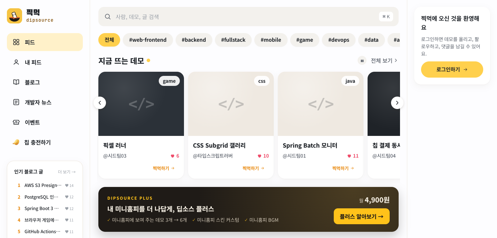
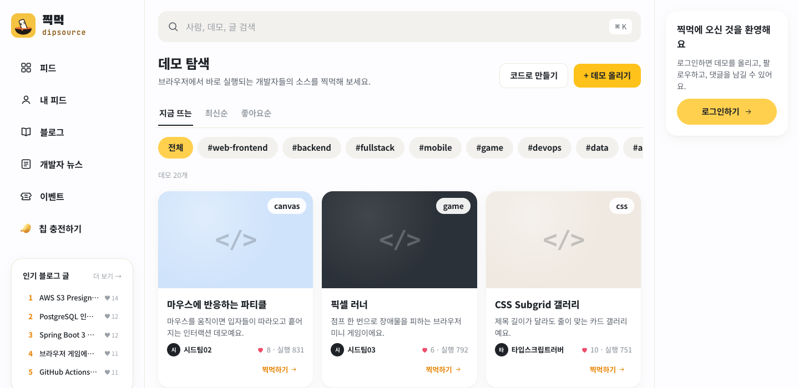
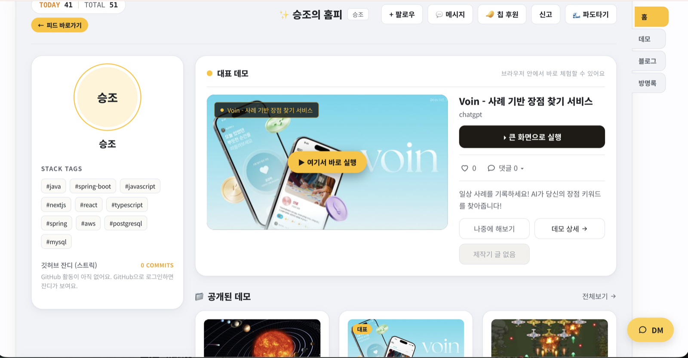
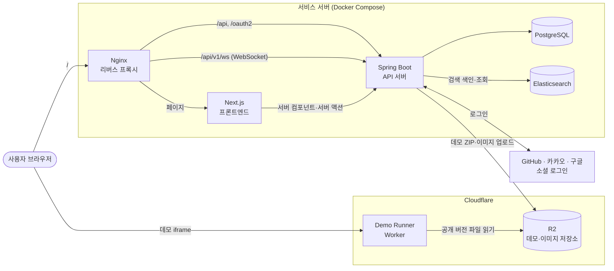
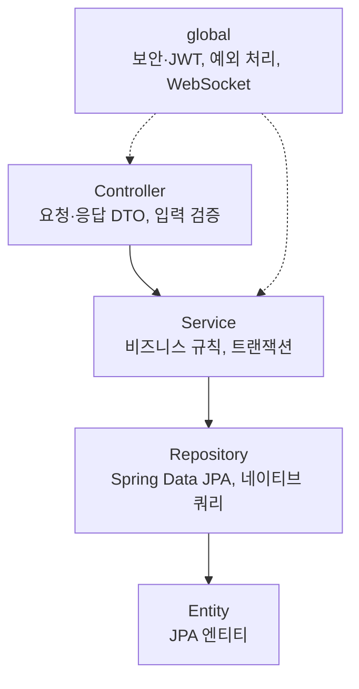
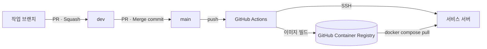

# 찍먹 (Dip Source)

**코드를 읽기 전에, 서비스를 먼저 경험하는 개발자 SNS**

개발자는 자신의 프로젝트에서 보여주고 싶은 핵심 기능을 데모로 올리고, 다른 개발자는 설치 없이 브라우저에서 바로 체험합니다. 데모를 중심으로 미니홈피, 피드, 블로그가 연결되어 결과물을 발견하고, 경험하고, 만든 사람과 소통하는 흐름을 만듭니다.

> 현재 개발 중인 서비스입니다. 칩 가격, 플러스 요금 등 금액은 임시값이며 바뀔 수 있습니다.



## 프로젝트 소개

| 항목 | 내용 |
| --- | --- |
| 서비스 주소 | https://dipsource.newlecture.com |
| 목표 | 개발 결과물을 쉽고 재미있게 경험하고 사람들과 연결되는 공간 만들기 |
| 팀 규모 | 5명 |
| 핵심 가치 | 설치하는 번거로움은 줄이고, 경험하는 즐거움은 높인다 |
| 핵심 기능 | 데모 체험 |
| 연결 기능 | 미니홈피, 피드, 블로그, DM, 알림 |

### 기획 배경

개발자가 프로젝트를 공유하는 대표적인 방법은 GitHub이지만, 다른 사람의 프로젝트를 **직접 경험**하기에는 불편함이 있습니다.

| 문제 | 내용 |
| --- | --- |
| 실행까지의 번거로움 | 배포 링크가 없으면 클론, 환경 설정, 의존성 설치를 거쳐야 실행할 수 있습니다. |
| 가벼운 체험에 비해 큰 진입장벽 | 로그인 화면 하나, 애니메이션 하나를 보고 싶어도 프로젝트 전체를 준비해야 합니다. |
| 발견하고 관심을 이어갈 공간 부족 | 프로젝트를 경험한 뒤 그 개발자의 다른 결과물과 글을 이어서 보기 어렵습니다. |

찍먹은 코드 공유 플랫폼을 대체하지 않습니다. 코드나 문서를 보기 전에 프로젝트에 관심을 갖게 하는 상호보완적인 공간을 목표로 합니다.

### 주요 타깃 사용자

- 자신의 프로젝트를 보여주고 피드백을 받고 싶은 개발자
- 다른 사람의 구현 사례를 직접 경험하며 배우고 싶은 개발자
- 학습한 기술과 문제 해결 경험을 글로 정리하고 수익을 얻고 싶은 개발자

## 핵심 이용 흐름

1. **발견 (피드):** 개발자 A가 피드에 새로 만든 기능을 데모와 함께 소개합니다.
2. **관심 (미니홈피):** 흥미를 느낀 개발자 B가 A의 미니홈피를 방문합니다.
3. **경험 (데모):** B가 미니홈피에 전시된 데모를 설치 없이 바로 체험합니다.
4. **학습 (블로그):** B가 A의 블로그에서 그 기능의 구현 과정을 읽고, 심화 시리즈를 구매합니다.
5. **연결 (팔로우·DM):** B가 A를 팔로우하고 댓글이나 DM으로 소통합니다.

**데모**는 프로젝트 전체가 아니라 개발자가 가장 보여주고 싶은 기능 하나를 실행 가능한 형태로 올린 것입니다. 데모는 피드 글과 블로그 글에 첨부할 수 있고, 미니홈피에 전시할 수 있습니다.

## 주요 기능



### 데모

| 기능 | 내용 |
| --- | --- |
| 데모 올리기 | 정적 웹 결과물을 ZIP으로 올리거나, 브라우저 코드 편집기(코드로 만들기)에서 바로 만듭니다. |
| 버전 관리 | 데모마다 여러 버전을 올리고, 공개할 버전을 골라 바꿀 수 있습니다. |
| 체험 | "찍먹하기"를 누르면 별도 도메인의 격리된 화면에서 데모가 바로 실행됩니다. |
| 탐색 | 지금 뜨는·최신순·좋아요순 정렬과 태그 필터로 데모를 찾습니다. |
| 인벤토리 | 회원마다 데모를 보관하는 칸이 있고, 칩으로 칸을 늘릴 수 있습니다. |
| 첨부 | 데모를 피드 글과 블로그 글에 붙여 소개할 수 있습니다. |

### 피드

| 기능 | 내용 |
| --- | --- |
| 글쓰기 | 최대 500자 짧은 글, 이미지·링크·데모 첨부, `#태그`로 태그 피드에 모입니다. |
| 타임라인 | 최신·추천·팔로잉 탭과 무한 스크롤로 글을 탐색합니다. |
| 반응 | 좋아요, 댓글, 리포스트, 북마크 |
| 추천 | 관심 태그와 반응을 바탕으로 추천 피드를 만듭니다. |

### 미니홈피



| 기능 | 내용 |
| --- | --- |
| 프로필 | 자기소개, 기술 스택, GitHub 공개 프로필 연동 |
| 데모 전시 | 대표 데모를 골라 전시합니다 (일반 3개, 플러스 6개). |
| 방명록·일촌평 | 방문자가 방명록을 남기고, 팔로우한 회원은 일촌평을 남깁니다. |
| 꾸미기 | 스킨, BGM (플러스), TODAY/TOTAL 방문자 수 |

### 블로그

| 기능 | 내용 |
| --- | --- |
| 글쓰기 | 마크다운 기술 글, 카테고리·태그, 데모 첨부 |
| 탐색 | 최신·인기·추천순 정렬, 카테고리 필터, 오늘의 아티클 순위 |
| 유료 글 | 원하는 글만 골라 칩으로 잠금 해제하도록 설정합니다. |
| 시리즈 | 글을 회차로 묶어 연재하고, 시리즈 단위로 판매합니다. 인기 연재 시리즈를 홈에 보여줍니다. |

### 소통

| 기능 | 내용 |
| --- | --- |
| 팔로우 | 팔로우·팔로잉 목록, 목록에서 바로 차단 |
| DM | 1대1 실시간 대화, 읽음 표시, 새 메시지 알림. 팔로우하지 않아도 보낼 수 있습니다. |
| 알림 | 팔로우, 좋아요, 댓글·답글, 북마크, 시리즈 구매, 새 회차 알림을 실시간으로 받습니다. |
| 차단·신고 | 서로 차단한 회원의 콘텐츠는 보이지 않고, 부적절한 콘텐츠는 신고할 수 있습니다. |

### 탐색과 기타

| 기능 | 내용 |
| --- | --- |
| 검색 | 사람, 데모, 글 통합 검색과 자동완성, 인기 검색어 |
| 랭킹 | 데모 좋아요, 블로그 조회, 팔로워, 미니홈피 방문 순위 (오늘·이번 주·이번 달) |
| 개발자 뉴스 | 개발 관련 뉴스 모아 보기 |
| 이벤트 | 운영자가 여는 이벤트 |

### 관리자

회원·권한 관리, 피드·블로그 글·댓글·데모 관리, 신고 처리, 칩 거래와 환불, 매출·정산, 이상 거래 확인, 이벤트 관리를 제공합니다.

## 칩과 결제

### 결제 수단

| 종류 | 결제 수단 | 사용처 |
| --- | --- | --- |
| 칩 | 현금으로 충전 (1칩 = 200원) | 유료 블로그 글 구매, 데모 인벤토리 칸 추가 |
| 시리즈 구매 | 현금 (작가가 가격 설정) | 시리즈 안의 유료 회차 전체 열람 |
| 딥소스 플러스 | 현금 월 구독 (월 4,900원) | 플러스 혜택 |

현재 실제 PG 결제는 연동하지 않았고, 결제 요청 즉시 충전·구매가 완료됩니다. PG 검증은 나중에 한 곳에 붙일 수 있도록 분리해 두었습니다.

### 블로그 유료 콘텐츠

- **단독 유료 글:** 칩으로 한 편씩 구매합니다. 유료 글은 1000자 이상이어야 올릴 수 있습니다.
- **시리즈:** 인프런처럼 한 번 사면 이후 올라오는 회차까지 계속 볼 수 있습니다. 시리즈 안의 유료 회차는 한 편씩 팔지 않고 시리즈 구매로만 열람합니다.
- 작가는 무료 글로 콘텐츠 품질을 먼저 보여주고, 원하는 글만 골라 유료로 전환할 수 있습니다.

### 딥소스 플러스

| 혜택 | 일반 | 플러스 |
| --- | --- | --- |
| 미니홈피 데모 전시 | 3개 | 6개 |
| 데모 인벤토리 | 기본 6칸 | +2칸 |
| 미니홈피 스킨 커스텀 | - | O |
| 미니홈피 BGM | - | O |
| 프로필 고급 배지 | - | O |

### 정산

창작자 수익은 관리자가 정산하며, 정산 시 수수료 30%를 뗍니다. 환불은 칩 충전 건만 관리자가 처리합니다.

## 운영 원칙

- 서로 차단한 회원의 글과 시리즈는 서로에게 보이지 않고, DM도 주고받을 수 없습니다.
- DM은 팔로우 여부와 관계없이 보낼 수 있고, 일촌평은 팔로우한 회원만 남길 수 있습니다.
- 칩의 모든 증감은 거래 내역에 기록하고, 잔액과 거래 내역이 항상 맞도록 관리합니다.
- 자기 시리즈는 살 수 없고, 구매자가 있는 시리즈는 삭제할 수 없습니다.
- 부적절한 게시물·댓글·데모는 신고할 수 있으며, 관리자가 검토해 처리합니다.

## 시스템 설계

### 전체 구조



| 구성 요소 | 역할 |
| --- | --- |
| Nginx | 한 도메인으로 들어온 요청을 경로에 따라 프론트엔드와 API 서버로 나눕니다. WebSocket 업그레이드도 처리합니다. |
| Next.js | 화면을 서버에서 렌더링합니다. 데이터는 서버 컴포넌트와 서버 액션에서 API 서버를 호출해 가져옵니다. |
| Spring Boot | 인증, 비즈니스 로직, 결제·정산, 실시간 메시지를 처리하는 REST API 서버입니다. |
| PostgreSQL | 회원, 글, 데모, 결제 등 서비스 데이터를 저장합니다. |
| Elasticsearch | 통합 검색과 자동완성을 처리합니다. 사용할 수 없으면 PostgreSQL 검색으로 대신합니다. |
| Cloudflare R2 | 데모 파일과 이미지를 저장합니다. |
| Demo Runner | 데모를 서비스와 다른 도메인에서 실행해, 데모 코드가 서비스 쿠키나 화면에 접근하지 못하게 합니다. |

### 백엔드 구조



도메인별로 패키지를 나눕니다.

| 도메인 | 패키지 |
| --- | --- |
| 회원·인증 | `user`, `follow`, `block`, `badge` |
| 데모 | `demo` (업로드, 버전, 미리보기, 용량 제한, 썸네일) |
| 피드 | `feed`, `tag`, `bookmark` |
| 블로그 | `post` (글, 댓글, 유료 글, 시리즈) |
| 미니홈피 | `minihome`, `github` |
| 소통 | `dm`, `notification`, `report` |
| 결제 | `coin`, `subscription`, `settlement`, `donation` |
| 탐색 | `search`, `ranking`, `news`, `event` |
| 관리자 | `admin` |

### 주요 설계 결정

| 주제 | 결정 |
| --- | --- |
| 인증 | 소셜 로그인 후 JWT(Access + Refresh)를 HttpOnly 쿠키로 주고받습니다. |
| 실시간 DM·알림 | 로그인한 회원마다 WebSocket(STOMP) 연결 하나를 두고, 개인 채널(`/user/queue/...`)로 DM, 읽음, 알림을 보냅니다. 메시지는 **DB 커밋이 끝난 뒤에만** 보내서, 저장에 실패한 내용이 화면에 뜨지 않게 합니다. |
| 칩 결제 동시성 | 칩을 차감할 때 회원 행을 비관적 잠금(`SELECT ... FOR UPDATE`)으로 잠가 동시 결제로 잔액이 꼬이지 않게 합니다. 두 회원이 관련되면 ID 순서로 잠가 교착을 막습니다. |
| 중복 처리 | 좋아요, 북마크, 글·시리즈 구매는 `ON CONFLICT DO NOTHING`으로 저장해 같은 요청이 두 번 와도 한 번만 반영합니다. 알림도 처음 저장될 때만 보냅니다. |
| 데모 격리 | 검증이 끝난 ZIP만 버전 전용 경로에 올리고, 공개 포인터가 가리키는 버전만 Worker가 내려 줍니다. 미리보기는 서명된 URL로만 열립니다. |
| 데모 업로드 | R2로 파일을 보내는 동안에는 DB 트랜잭션을 잡지 않습니다. 실패하면 올린 파일을 지우고 버전을 실패 상태로 남깁니다. |
| 검색 | 기본은 Elasticsearch이고, 연결할 수 없으면 PostgreSQL 검색으로 자동 전환합니다. |
| 스키마 | JPA로 테이블을 관리하고, 기존 CHECK 제약처럼 자동으로 바뀌지 않는 부분은 `schema.sql`로 보정합니다. |

### 배포



`main`에 머지되면 GitHub Actions가 백엔드, 프론트엔드, Elasticsearch 이미지를 빌드해 GHCR에 올립니다. 그다음 서버에 접속해 `docker compose`로 새 이미지를 받아 다시 띄웁니다. 데모 Worker는 Cloudflare에 따로 배포합니다 ([docs/데모-플랫폼-배포.md](docs/데모-플랫폼-배포.md)).

DB 구조는 [docs/테이블정의서.md](docs/테이블정의서.md)와 [docs/database-design.md](docs/database-design.md)에 정리되어 있습니다.

## 기술 스택

| 구분 | 스택 |
| --- | --- |
| Backend | Java 21, Spring Boot 3.4, Spring Security, Spring Data JPA, JWT |
| Frontend | Next.js 16 (App Router), React 19, TypeScript |
| Database | PostgreSQL 16 |
| 검색 | Elasticsearch 8 |
| 실시간 | WebSocket + STOMP (DM, 알림) |
| 인증 | 소셜 로그인 (GitHub, 카카오, 구글) |
| 파일 저장·데모 실행 | Cloudflare R2, Cloudflare Workers |
| Infra | Docker Compose, Nginx, GitHub Actions |

## 실행 방법

자세한 환경 설정은 [docs/환경설정.md](docs/환경설정.md)를 참고하세요.

### Backend

```bash
cd backend
./gradlew bootRun
```

- 기본 포트: `8080`
- PostgreSQL 필요 (`localhost:5432/dipsource`)

### Frontend

```bash
cd frontend
npm install
npm run dev
```

- 기본 포트: `3000`

## 문서

| 문서 | 내용 |
| --- | --- |
| [docs/기획서.md](docs/기획서.md) | 기획 배경, 서비스 소개, 차별점 |
| [docs/테이블정의서.md](docs/테이블정의서.md) | 테이블 컬럼·제약조건 |
| [docs/백엔드-청사진.md](docs/백엔드-청사진.md) | API 구현 현황 |
| [docs/FRONTEND.md](docs/FRONTEND.md) | 프론트엔드 개발 규칙 |
| [AGENTS.md](AGENTS.md) | Git 협업 규칙 (브랜치, 커밋, PR) |
| [docs/README.md](docs/README.md) | 전체 문서 안내 |

## 팀원

| 이름 | 역할 |
| --- | --- |
| 승조 | |
| 다윗 | |
| 진엽 | |
| 준하 | DM, 블로그, 팔로우 |
| 재인 | |
