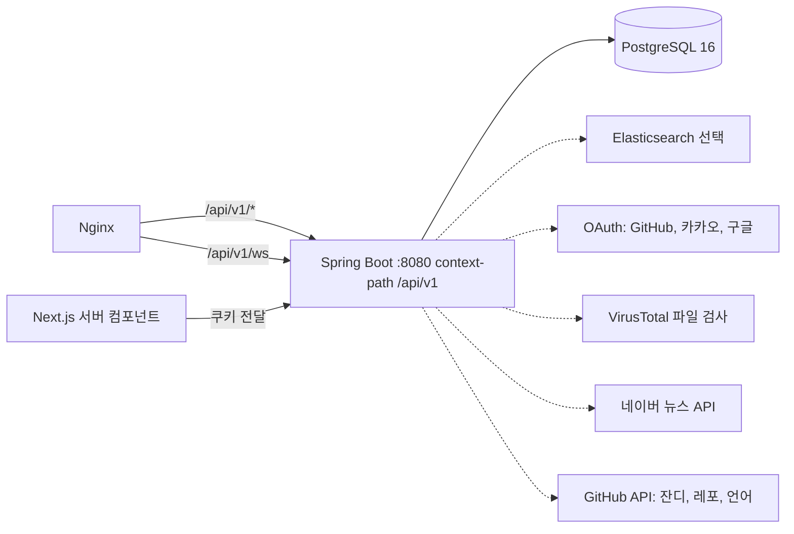

# 찍먹 백엔드 청사진

> 백엔드 API 구현 현황과 남은 작업을 한곳에 모은 문서다. 프론트 연동 상태는 [프론트엔드-청사진.md](./프론트엔드-청사진.md)를 본다.

| 항목 | 내용 |
| --- | --- |
| 스택 | Java 21 · Spring Boot 3.4.1 · Spring Security · JPA · Gradle · PostgreSQL 16 |
| API 기준 | WBS5 시트 (`WBS5(페이지 모든 요소 AI)`) |
| API prefix | `server.servlet.context-path=/api/v1` (컨트롤러는 `/feeds`처럼 상대 경로만 쓴다) |
| DB 기준 | ERDCloud `ERD_v2` (확인한 테이블 39개) |
| 인증 · 실시간 | 소셜 로그인(GitHub·카카오·구글) + JWT / WebSocket + STOMP + SockJS |
| 검색 | Elasticsearch(선택) + PostgreSQL fallback |
| 개발 규칙 | [BACKEND.md](./BACKEND.md), [환경설정.md](./환경설정.md) |
| 배포 | Docker Compose + Nginx |

목차: [1. 현재 상태](#1-현재-상태) · [2. 아키텍처](#2-아키텍처) · [3. 폴더 구조](#3-폴더-구조-3계층) · [4. API 전체](#4-api-전체) · [5. 도메인과 테이블](#5-도메인과-테이블) · [6. 구현 순서](#6-구현-순서) · [7. 작업 규칙](#7-작업-규칙) · [8. 확인이 필요한 항목](#8-확인이-필요한-항목)

---

## 1. 현재 상태

2026-11-09 기준 (`origin/dev`).

| 구분 | 상태 | 내용 |
| --- | --- | --- |
| 백엔드 | 진행 중 | 인증(OAuth+JWT+refresh), 피드 CRUD·추천·좋아요/리포스트/북마크/댓글·좋아요, 팔로우·차단, DM WebSocket, ES 통합 검색, 뉴스, 신고, 이미지 업로드(R2), 미니홈피(조회/수정/방명록/일촌평/대표 데모·대표 글), 블로그 CRUD·댓글·댓글 좋아요, 관리자(대시보드·회원 제재·콘텐츠·신고·검색 운영), **칩 충전·거래 내역**, 데모(업로드·R2/Worker 실행·좋아요·댓글) 완료. 알림·순위·유료 글 구매·구독·정산은 스텁/미구현 |
| 프론트 연동 | 부분 연결 | 피드·로그인·블로그(CRUD·댓글)·미니홈피·DM·검색·신고·관리자(대시보드·회원·콘텐츠·신고)·**칩 충전·거래 내역** 실연동. 데모·알림·순위·유료 글 구매·구독·일부 내 정보/관리자 화면은 목 또는 준비 중 |
| 문서 | 정리 필요 | 기존 `기획서.md`, `테이블정의서.md`, `BACKEND.md`가 WBS5·ERD_v2보다 오래됨 |

**백엔드 실행** — PostgreSQL 16이 필요하다([환경설정.md](./환경설정.md)).

```bash
cd backend
./gradlew bootRun
```

**기준 자료의 우선순위**

| 대상 | 기준 | 비고 |
| --- | --- | --- |
| API 경로·메서드 | 구글 시트 '응용프로젝트 1팀 WBS'의 `WBS5(페이지 모든 요소 AI)` | 가장 마지막에 수정된 시트 |
| DB 테이블·컬럼 | ERDCloud `ERD_v2` | 목록 하단에 더 있을 수 있어 구현 시 재확인 |
| 기능 요구 | `기획서.md` | |
| 코딩·Git 규칙 | `BACKEND.md`, `AGENTS.md` | |

## 2. 아키텍처



- **인증:** 소셜 로그인 후 Access/Refresh JWT를 발급하고 httpOnly 쿠키로 내려준다. Refresh는 DB 해시 저장 후 Rotation한다. `POST auth/refresh`로 Access를 갱신한다.
- **경로:** 외부 호출은 항상 `/api/v1/...`. 컨트롤러·Security 매처는 context-path 밖의 상대 경로(`/feeds`, `/oauth2/**` 등)만 적는다.
- **실시간:** DM은 WebSocket + STOMP + SockJS (`/api/v1/ws`). 알림 실구현은 아직이다.
- **검색:** Elasticsearch가 있으면 ES, 없으면 PostgreSQL로 fallback.
- **응답 규격:** 성공 `{ "data": ... }`, 목록은 `content/page/size/totalElements/totalPages`(커서 목록은 `content/hasNext/nextCursor`), 오류 `{ "error": { "code", "message" } }`.

## 3. 폴더 구조 (3계층)

"요청을 받는 층 → 업무를 처리하는 층 → 데이터를 다루는 층"으로 나눈다. 패키지는 `backend/src/main/java/com/dipsource`다.

```text
com/dipsource
├─ DipSourceApplication.java
├─ global/                      전역 설정, 도메인 로직 금지
│  ├─ config/                   Security, Cors, WebSocket
│  ├─ auth/                     JWT 필터, OAuth2 핸들러
│  ├─ exception/                BusinessException, ErrorCode, GlobalExceptionHandler
│  └─ common/                   BaseEntity, ApiResponse, PageResponse
├─ controller/<도메인>/         [1층] 요청 파싱, 응답 포장만
├─ service/<도메인>/            [2층] 서비스 인터페이스
│  └─ impl/                     서비스 구현체 (비즈니스 로직, @Transactional)
├─ repository/<도메인>/         [3층] 데이터 접근
├─ entity/<도메인>/             [3층] JPA 엔티티
└─ dto/<도메인>/                record 요청/응답, from(Entity)
```

- 다른 도메인의 repository·entity를 직접 쓰지 않고 그 도메인의 service를 거친다.
- 엔티티를 응답으로 직접 반환하지 않는다. 연관관계는 `LAZY` 단방향이 기본이다.
- 칩 차감처럼 경쟁 조건이 있는 작업은 비관적 잠금(`SELECT ... FOR UPDATE`)을 쓴다.

## 4. API 전체

WBS5 기준. 모든 경로는 `/api/v1/`로 시작한다. **연결됨**은 프론트 메인 피드 화면이 이미 이 경로로 호출하게 만들어 둔 항목이다.

### 1 회원

| 메서드 | 경로 | 페이지 | 비고 | 상태 |
| --- | --- | --- | --- | --- |
| GET | `auth/login/{provider}` | `/login` | OAuth 리다이렉트 방식 | ✅ 완료 |
| POST | `auth/dev-login` | `/login/dev` | 로컬 시드 계정 로그인 (개발용) | ✅ 완료 |
| POST | `users/me/profile` | `/onboarding` | 최초 로그인 추가 정보 | ✅ 완료 |
| POST | `auth/logout` | `/my` | 해당 Refresh family를 서버에서 폐기한 뒤 쿠키 삭제 | ✅ 완료 |
| POST | `auth/refresh` | 공통 | DB 해시 검증 + Token Rotation. 30초 유예 | ✅ 완료 |
| GET | `users/me` | 공통, `/my` | 팔로워·팔로잉·칩 수 포함 | ✅ 완료 |
| GET | `users/nicknames/available` | `/onboarding` | 닉네임 중복 확인 | ✅ 완료 |
| PUT | `users/me` | `/my` | 내 정보 수정 | ✅ 완료 |
| DELETE | `users/me` | `/my` | 회원 탈퇴 | ✅ 완료 |
| PUT | `users/me/presence` | 공통 | last_active_at 하트비트 | ✅ 완료 |
| GET | `users/{userId}` | `/mini-home/[userId]` | 다른 사용자 프로필 | ✅ 완료 |
| POST | `users/{targetUserId}/report` | `/mini-home/[userId]` | 유저 신고 | ✅ 완료 |
| GET · PUT | `users/me/settings` | `/my/settings` | 설정 조회·수정 | ❌ 미구현 |

### 2 피드

| 메서드 | 경로 | 페이지 | 비고 | 상태 |
| --- | --- | --- | --- | --- |
| GET | `feeds?type=recommended` | `/main` | 추천 피드 | ✅ 완료 |
| GET | `feeds?type=following` | `/main` | 팔로잉 피드 | ✅ 완료 |
| POST | `feeds` | `/main` | 500자 제한 | ✅ 완료 |
| GET | `feeds/{feedId}` | `/feeds/[feedId]` | 상세 조회 | ✅ 완료 |
| PUT | `feeds/{feedId}` | `/feeds/[feedId]` | 수정 | ✅ 완료 |
| DELETE | `feeds/{feedId}` | `/feeds/[feedId]` | 삭제 (소프트) | ✅ 완료 |
| GET | `tags` | `/main` | 태그 목록 | ✅ 완료 |
| POST · DELETE | `feeds/{feedId}/like` | `/main`, `/feeds/[feedId]` | 좋아요·취소 | ✅ 완료 |
| POST · DELETE | `feeds/{feedId}/repost` | `/main`, `/feeds/[feedId]` | 리포스트·취소 | ✅ 완료 |
| POST · DELETE | `feeds/{feedId}/bookmark` | `/main`, `/feeds/[feedId]` | 북마크·취소 | ✅ 완료 |
| GET | `users/me/feeds` | `/my/feeds` | 내가 쓴 피드 목록 | ✅ 완료 |
| POST | `feeds/{feedId}/report` | `/main`, `/feeds/[feedId]` | 신고 | ✅ 완료 (report 공통) |
| GET · POST | `feeds/{feedId}/comments` | `/feeds/[feedId]` | 댓글 목록·작성 | ✅ 완료 |
| GET | `feeds/comments/{commentId}/replies` | `/feeds/[feedId]` | 대댓글 목록 | ✅ 완료 |
| PUT · DELETE | `feeds/comments/{commentId}` | `/feeds/[feedId]` | 댓글 수정·삭제 | ✅ 완료 |
| POST · DELETE | `feeds/comments/{commentId}/like` | `/feeds/[feedId]` | 댓글 좋아요·취소 | ✅ 완료 |
| POST | `feeds/comments/{commentId}/report` | `/feeds/[feedId]` | 피드 댓글 신고 | ✅ 완료 |
| GET | `users/me/reposts` | `/my` | 내가 리포스트한 피드 | ✅ 완료 |
| POST | `images` | 공통 | multipart 이미지 업로드 (R2) | ✅ 완료 |

### 3 소셜 · 4 검색

| 메서드 | 경로 | 페이지 | 비고 | 상태 |
| --- | --- | --- | --- | --- |
| POST · DELETE | `follows/{userId}` | `/main`, `/feeds/[feedId]`, `/mini-home/[userId]` | 팔로우·언팔로우 | ✅ 완료 |
| GET | `follows/followings?q=` | 공통(우측 사이드), `/my/follows` | 무한 스크롤, `q`로 닉네임 검색 | ✅ 완료 |
| GET | `follows/followers?q=` | `/my/follows` | 무한 스크롤, `q`로 닉네임 검색 | ✅ 완료 |
| GET | `follows/followings/presence?userIds=` | 공통(우측 사이드) | 화면에 나온 팔로잉의 접속 상태 (활동 회원만, 최대 100개) | ✅ 완료 |
| GET | `blocks` | `/my/settings` | 내가 차단한 목록 | ✅ 완료 |
| POST · DELETE | `blocks/{userId}` | `/main`, `/feeds/[feedId]`, `/my/settings` | 차단·해제. 차단하면 팔로우·블로그 글 북마크를 양쪽 모두 지운다 (해제해도 복구 안 함) | ✅ 완료 |
| GET | `dm/rooms` | `/dm` | 대화방 목록 | ✅ 완료 |
| GET | `dm/{userId}` | `/dm/[userId]` | 대화 내역 | ✅ 완료 |
| WS | `dm` | `/dm/[userId]` | WebSocket(STOMP) 전송 | ✅ 완료 |
| GET | `search?q=&type=` | `/search` | 통합 검색 (ES 우선, 없으면 PG) | ✅ 완료 |
| GET | `search/autocomplete?q=` | 공통(검색창) | 검색어 자동완성 (사전·태그·공개 제목 단어, 최대 8개) | ✅ 완료 |
| POST | `search/hidden` | `/search` | 검색 결과 숨김 | ✅ 완료 |
| DELETE | `search/hidden/{type}/{id}` | `/search` | 숨김 해제 | ✅ 완료 |
| GET | `search/hidden` | - | 내가 숨긴 결과 목록 | ✅ 완료 |
| POST | `search/visits` | `/search` | 검색 결과 방문 기록 | ✅ 완료 |
| GET | `search/popular` | 공통(검색창) | 인기 검색어 | 🔲 스텁 (빈 응답) |

### 5 블로그

| 메서드 | 경로 | 페이지 | 상태 |
| --- | --- | --- | --- |
| GET | `posts?category=&q=&sort=` | `/blog` | ✅ 완료 (sort: latest·popular, recommended는 아직 latest) |
| GET | `users/{userId}/posts` | `/blog/[userId]` | ✅ 완료 |
| POST | `posts` | `/blog/write` | ✅ 완료 |
| GET · DELETE | `posts/{postId}` | `/blog/posts/[postId]` | ✅ 완료 (잠긴 유료 글은 앞 3문단만, 삭제는 soft delete, 조회수는 로그인 회원 1시간 1회) |
| PUT | `posts/{postId}` | `/blog/posts/[postId]/edit` | ✅ 완료 |
| POST | `posts/{postId}/report` | `/blog/posts/[postId]` | ✅ 완료 (report 공통) |
| POST · DELETE | `posts/{postId}/like` | `/blog/posts/[postId]` | 🔄 PR 리뷰 중 (#147) |
| POST · DELETE | `posts/{postId}/bookmark` | `/blog/posts/[postId]` | ✅ 완료 (멱등, 삭제·차단 글은 404, 상세에 `bookmarked`. 내 북마크 목록 `users/me/bookmarks`는 아직 스텁) |
| GET · POST | `posts/{postId}/comments` | `/blog/posts/[postId]` | ✅ 완료 (커서 페이지) |
| PUT · DELETE | `posts/comments/{commentId}` | `/blog/posts/[postId]` | ✅ 완료 |
| POST · DELETE | `posts/comments/{commentId}/like` | `/blog/posts/[postId]` | ✅ 완료 |

### 6 미니홈피

| 메서드 | 경로 | 페이지 | 비고 | 상태 |
| --- | --- | --- | --- | --- |
| GET | `mini-homes/{userId}` | `/mini-home/[userId]` | 미니홈피 조회 | ✅ 완료 |
| GET | `mini-homes/{userId}/visitors` | `/mini-home/[userId]` | 방문자 통계 | ✅ 완료 |
| POST | `mini-homes/{userId}/visits` | `/mini-home/[userId]` | 방문 카운트 | ✅ 완료 |
| GET | `mini-homes/random` | `/mini-home/[userId]` | 파도타기 | ✅ 완료 |
| GET | `users/{userId}/github/{contributions\|repos\|languages}` | `/mini-home/[userId]` | 잔디·대표 레포·언어 통계 | ✅ 완료 |
| GET | `mini-homes/{userId}/comments` | `/mini-home/[userId]` | 일촌평 목록. updated_at 최신순 | ✅ 완료 |
| POST | `mini-homes/{userId}/comments` | `/mini-home/[userId]` | 일촌평 작성. 맞팔만, 1인 1개, 본인 불가 | ✅ 완료 |
| DELETE | `mini-homes/comments/{commentId}` | `/mini-home/[userId]` | 일촌평 삭제 (작성자/주인) | ✅ 완료 |
| GET | `mini-homes/{userId}/guestbook` | `/mini-home/[userId]/guestbook` | 방명록 목록. 비밀글은 작성자·주인만 내용 | ✅ 완료 |
| POST | `mini-homes/{userId}/guestbook` | `/mini-home/[userId]/guestbook` | 방명록 작성. 500자, 여러 번 | ✅ 완료 |
| DELETE | `mini-homes/guestbook/{guestbookId}` | `/mini-home/[userId]/guestbook` | 방명록 삭제 (작성자/주인) | ✅ 완료 |
| POST | `mini-homes/{homeUserId}/guestbook/{guestbookId}/report` | `/mini-home/[userId]/guestbook` | 방명록 신고 | ✅ 완료 |
| PUT | `mini-homes/me` | `/mini-home/[userId]/edit` | 미니홈피 수정(본인만) | ✅ 완료 |
| PUT | `mini-homes/me/featured-demo` | `/mini-home/[userId]/edit` | 대표 데모 설정 | ✅ 완료 |
| PUT | `mini-homes/me/featured-post` | `/mini-home/[userId]/edit` | 대표 글(제작기 글) 설정. 본인의 게시 중인 글만, null이면 해제 | ✅ 완료 |
| POST | `mini-homes/{userId}/donations` | `/mini-home/[userId]` | 미니홈피 후원. 본인 불가, 잔액 부족 시 400 | ✅ 완료 |
| GET | `demos?userId={userId}` | `/mini-home/[userId]/demos` | 사용자 데모 목록 (본인 조회 시 초안 포함) | ✅ 완료 |

### 7 데모

| 메서드 | 경로 | 페이지 | 비고 | 상태 |
| --- | --- | --- | --- | --- |
| POST | `demos` | `/demos/upload` | 초안 등록 (JSON) | ✅ 완료 |
| POST | `demos/{demoId}/versions` | `/demos/upload`, `/demos/[demoId]/manage` | zip 업로드·검증 → 새 버전 | ✅ 완료 |
| POST | `demos/{demoId}/publish` · `unpublish` | `/demos/[demoId]/manage` | 공개·공개 해제 (R2 공개 포인터와 함께 변경) | ✅ 완료 |
| GET | `demos?tag=&sort=&userId=&cursor=` | `/demos` | 목록 (커서) | ✅ 완료 |
| GET | `demos?sort=trending` | `/main` | 지금 뜨는 데모 (임시 기준: 실행 수) | ✅ 완료 |
| GET · PUT · DELETE | `demos/{demoId}` | `/demos/[demoId]`, `/demos/[demoId]/manage` | 상세·수정·삭제 | ✅ 완료 |
| POST | `demos/{demoId}/play` | `/demos/[demoId]` | 찍먹하기(체험 카운트) | ✅ 완료 |
| POST · DELETE | `demos/{demoId}/like` | `/demos/[demoId]` | 좋아요·취소 | ✅ 완료 |
| POST · DELETE | `demos/{demoId}/bookmark` | `/demos/[demoId]` | 나중에 해보기 | ✅ 완료 |
| POST | `demos/{demoId}/report` | `/demos/[demoId]` | 신고 | ✅ 완료 (report 공통) |
| GET · POST | `demos/{demoId}/comments` | `/demos/[demoId]` | 댓글 목록(커서)·작성 | ✅ 완료 |
| PUT · DELETE | `demos/comments/{commentId}` | `/demos/[demoId]` | 댓글 수정·삭제 | ✅ 완료 |
| POST · DELETE | `demos/comments/{commentId}/like` | `/demos/[demoId]` | 댓글 좋아요 | ✅ 완료 |
| GET | `demos/usage` | `/demos/upload`, `/demos/[demoId]/manage` | 내 사용량·남은 용량 | ✅ 완료 |
| POST | `demos/previews` | `/demos/upload` | 임시 업로드 미리보기 (서명 URL) | ✅ 완료 |
| GET | `demos/{demoId}/versions` | `/demos/[demoId]/manage` | 버전 목록 | ✅ 완료 |
| DELETE | `demos/{demoId}/versions/{versionId}` | `/demos/[demoId]/manage` | 보관 버전 삭제 | ✅ 완료 |
| POST | `demos/{demoId}/versions/{versionId}/preview` | `/demos/[demoId]/manage` | 버전 미리보기 URL | ✅ 완료 |
| POST | `demos/{demoId}/versions/{versionId}/restore` | `/demos/[demoId]/manage` | 이전 버전 복구 | ✅ 완료 |
| POST | `demos/{demoId}/thumbnail` | `/demos/[demoId]/manage` | 썸네일 직접 올리기 | ✅ 완료 |
| POST | `demos/{demoId}/versions/editor` | `/demos/studio` | 코드 편집 결과를 새 버전으로 저장 | ✅ 완료 |
| GET · POST | `demos/{demoId}/versions/{versionId}/config` | `/demos/studio` | Mock API·샘플 데이터 조회·저장(새 버전) | ✅ 완료 |
| GET | `demo-templates`, `demo-templates/{key}` | `/demos/studio` | 찍먹 제공 템플릿 | ✅ 완료 |
| PUT · DELETE | `demos/{demoId}/backend` | `/demos/upload`, `/demos/[demoId]/manage` | 외부 백엔드 주소 등록·수정·해제 | ✅ 완료 |
| POST | `demos/{demoId}/backend/health-check` | `/demos/[demoId]` | 외부 백엔드 상태 확인 (기본 비활성) | ✅ 완료 |

### 8 알림 · 9 뉴스·순위 · 10 칩·구독

| 메서드 | 경로 | 페이지 | 비고 | 상태 |
| --- | --- | --- | --- | --- |
| GET | `notifications` | `/notifications` | 드롭다운/페이지 확정 필요 | 🔲 스텁 (빈 응답) |
| GET | `notifications/unread-count` | 공통(우측 사이드) | | 🔲 스텁 (0 반환) |
| PUT | `notifications/{notificationId}/read` | `/notifications` | 읽음 처리 | ❌ 미구현 |
| GET | `search/news?q=` | `/news` | 네이버 뉴스 API 프록시 | ✅ 완료 |
| GET | `rankings?type=` | `/rankings` | demo / blog / follower / home | 🔲 스텁 (빈 응답) |
| GET | `rankings?type=&period=weekly` | 공통(좌측 사이드) | 주간 순위 위젯 | 🔲 스텁 (빈 응답) |
| POST | `coins/purchases` | `/my/coins` | 칩 충전 | ✅ 완료 (PG no-op, verifyPayment() 교체 준비) |
| GET | `coins/history` | `/my/coins` | 충전·사용 내역 | ✅ 완료 |
| POST | `posts/{postId}/purchase` | `/blog/posts/[postId]` | 유료 글 칩 구매. 구매자 차감 + 글쓴이 판매 수익(BLOG_INCOME), 멱등. 무료 글·내 글·구독 중(해지했지만 만료 전 포함)이면 400 | ✅ 완료 |
| POST · DELETE | `subscriptions` · `subscriptions/me` | `/blog/[userId]`, `/my/subscription` | 블로그 구독(현금, PG no-op 즉시 결제, 한 달)·해지(만료일까지 열람). 딥소스 플러스(`plan`)는 400 | ✅ 완료 |
| GET | `subscriptions/me` | `/my/subscription` | 내 블로그 구독 목록 (만료 전) | ✅ 완료 |
| GET | `users/{userId}/subscription` | `/blog/[userId]` | 구독료·내 구독 여부·구독자 수 (비로그인 가능) | ✅ 완료 |

### 12~17 관리자

| 메서드 | 경로 | 페이지 | 상태 |
| --- | --- | --- | --- |
| GET | `admin/dashboard` | `/admin` | ✅ 완료 |
| GET | `admin/users?q=&status=` | `/admin/users` | ✅ 완료 |
| GET | `admin/users/{userId}` | `/admin/users/[userId]` | ✅ 완료 |
| PUT · DELETE | `admin/users/{userId}/ban` | `/admin/users/[userId]` (제재·해제) | ✅ 완료 |
| GET · DELETE | `admin/demos`, `admin/demos/{demoId}` | `/admin/demos` | ✅ 완료 |
| GET · DELETE | `admin/posts`, `admin/posts/{postId}` | `/admin/posts` | ✅ 완료 |
| GET · DELETE | `admin/feeds`, `admin/feeds/{feedId}` | `/admin/feeds` | ✅ 완료 |
| GET · DELETE | `admin/comments`, `admin/comments/{commentId}` | `/admin/comments` | ✅ 완료 (피드 댓글) |
| GET · DELETE | `admin/post-comments`, `admin/post-comments/{commentId}` | `/admin/post-comments` | ✅ 완료 (블로그 댓글. 블로그 댓글 신고 API가 없어 신고 수는 0) |
| GET | `admin/reports?type=&status=` | `/admin/reports` | ✅ 완료 |
| GET · PUT | `admin/reports/{reportId}` | `/admin/reports/[reportId]` | ✅ 완료 |
| GET | `admin/subscriptions` | `/admin/subscriptions` | ✅ 완료 (블로그 구독만, 해지·만료는 canceled) |
| GET | `admin/revenue?from=&to=` | `/admin/revenue` | ✅ 완료 (결제 완료 금액 월별 합계, 환불 제외, 기본 최근 6개월·최대 24개월. 대시보드 지난달 매출(`revenueMonth`)도 같은 계산) |
| GET | `admin/settlements` | `/admin/settlements` | ❌ 미구현 |
| PUT | `admin/settlements/{settlementId}/confirm` | `/admin/settlements` | ❌ 미구현 |
| GET | `admin/coins/purchases?userId=&type=` | `/admin/coins` | ✅ 완료 (칩 충전 결제, type=charge·refunded) |
| PUT | `admin/coins/purchases/{purchaseId}/refund` | `/admin/coins` | ❌ 미구현 |
| GET | `admin/coins/suspicious` | `/admin/coins/suspicious` | ❌ 미구현 |

### 검색 운영 (ADMIN)

| 메서드 | 경로 | 화면 | 설명 | 상태 |
|--------|------|------|------|------|
| POST | `admin/search/reindex` | - | 전체 재색인 | ✅ 완료 |
| POST | `admin/search/reindex/{type}/{id}` | - | 문서 하나 재색인 | ✅ 완료 |
| POST | `admin/search/reconcile` | - | 원본과 비교해 누락·잔존 복구 | ✅ 완료 |
| POST | `admin/search/outbox/retry` | - | 재시도 한도 초과분 재시도 | ✅ 완료 |
| GET | `admin/search/status` | - | 색인·대기열 상태 | ✅ 완료 |

### 범례

- ✅ 완료 — 실제 구현 + 프론트 연동 가능
- 🔄 PR 리뷰 중 — 코드 작성 완료, 머지 대기
- 🔲 스텁 — 빈 응답만 반환 (프론트 에러 방지용, `StubController`)
- ❌ 미구현 — 아직 코드 없음

## 5. 도메인과 테이블

백엔드 패키지 하나가 맡는 ERD_v2 테이블과 WBS5 그룹이다. 엔티티는 ERD_v2를 기준으로 만든다.

| 도메인 패키지 | ERD_v2 테이블 | WBS5 |
| --- | --- | --- |
| `user` (+auth) | users, social_accounts, refresh_tokens, user_interest_tags, user_tag_profile, user_sanctions | 1 회원 |
| `follow` · `block` | follows, blocks | 3 소셜 |
| `feed` | feeds, feed_likes, feed_comments, feed_comment_likes, feed_reposts, feed_tags, feed_votes | 2 피드 |
| `tag` | tags | 2.7 |
| `demo` | demos, demo_versions, demo_previews, demo_usages, demo_type_config, demo_tags, demo_likes, demo_feedbacks, demo_feedback_likes, bookmarks | 7 데모 |
| `post` | posts, post_comments, post_comment_likes, post_likes, post_tags, blog_subscriptions | 5 블로그 |
| `minihome` | mini_homes, guestbooks, mini_home_comments | 6 미니홈피 |
| `dm` | dm_rooms, dm_room_members, dm_messages | 3.7~3.9 |
| `notification` | notifications | 8 알림 |
| `coin` · `subscription` | chip_transactions, blog_subscriptions | 10 칩·구독 |
| `settlement` | settlements | 16.3~16.4 |
| `report` | reports | 2.12, 5.7, 7.12, 15 |
| `admin` | admins, admin_action_logs, user_sanctions | 12~17 |
| `search` · `ranking` · `news` | 전용 테이블 없음(집계, 외부 API) | 4, 9 |

**기존 문서와 다른 점**

- 댓글·좋아요가 `comments`/`likes` 다형성 테이블이 아니라 **도메인별 테이블**(`feed_*`, `post_*`, `demo_*`)이다.
- DM은 `dm_rooms`, `dm_room_members`, `dm_messages` 3개다.
- 도토리는 **칩**이다. `users.chip_balance`, `chip_transactions`.
- `bookmarks`는 데모 전용(`user_id`, `demo_id`). 피드·블로그 북마크는 각각 `feed_bookmarks`, `post_bookmarks`다.
- `feeds`: `content` 500자, `demo_id`, `like/comment/repost_count`, `poll_options`(JSONB), `status`, `deleted_at`.
- `users`: `nickname`, `profile_image`, `bio`, `tech_stacks`(JSONB), `github_username`, `role`, `status`, `chip_balance`.

## 6. 구현 순서

도메인마다 "엔티티+Repository → Service → Controller+DTO → 테스트"를 한 세트로 만든다. PR 하나는 목적 하나, 변경 400줄 이하를 권장한다.

| 단계 | 범위 | 상태 |
| --- | --- | --- |
| 0. 기반 | `ApiResponse`, 예외, `BaseEntity`, Security, `context-path=/api/v1` | ✅ 완료 |
| 1. 핵심 (MVP) | 인증(OAuth+JWT+refresh) → 피드 CRUD+추천 → 검색(ES) → 미니홈피 조회/수정 | ✅ 완료 |
| 1-1. MVP 잔여 | 팔로우 → 데모 → 블로그 | 🟡 팔로우·블로그 CRUD·댓글·데모 완료, 글 북마크 미완 |
| 2. 소셜·소통 | 피드 좋아요·북마크·리포스트, 댓글, DM, 방명록·일촌평, 알림, 순위, GitHub | 🟡 대부분 완료, 알림·순위 미구현 |
| 3. 수익화·관리 | 칩·구독, 정산, 신고·제재, 관리자 | 🟡 신고·제재·콘텐츠·대시보드·검색 운영·칩 충전·거래 내역 완료, 유료 글 구매·구독·정산 미구현 |
| 4. 부가 기능 | 개발 뉴스, 이벤트, 파도타기, 스킨·테마, 차단, 설정 | 🟡 뉴스·파도타기·차단·스킨 검증 완료, 이벤트·설정 API 미구현 |
| 5. 배포 | Docker Compose + Nginx | ✅ 완료 |

## 7. 작업 규칙

전체 규칙은 [AGENTS.md](../AGENTS.md)다. 자주 쓰는 것만 모았다.

| 구분 | 규칙 |
| --- | --- |
| 브랜치 | `타입/작업명`. 타입은 feat, fix, refactor, docs, test, chore, hotfix, perf, design. 영어 소문자와 하이픈만 쓰고 하나의 브랜치에는 하나의 작업만 담는다. 예: `feat/user-login-api`. `main`, `dev` 직접 푸시 금지 |
| 커밋 | `타입: 작업 내용` 형식. 제목은 한국어 50자 이내, 마침표 없음. 변경한 파일만 지정해서 add |
| PR | `dev`로 보내고 머지는 사람이 한다. 본문은 `.github/pull_request_template.md` 항목을 모두 채운다 |
| 검증 | `./gradlew test` 통과. 입력 검증 → 권한 확인 → 비즈니스 로직 → 저장 순서. 비정규화 카운트는 원본과 같은 트랜잭션에서 갱신 |
| 하지 말 것 | WBS5·기획서에 없는 API 가정, `.env`·키·토큰 커밋, `git push --force` |

## 8. 확인이 필요한 항목

아직 팀에서 정하거나 문서와 맞출 항목이다.

| 항목 | 출처 |
| --- | --- |
| 방문 카운트를 하루 1회로 제한할지 | WBS5 6.2 |
| 칩 사용(결제) API 정의 | WBS5 10.3 |
| 데모 파일 검사 진행률: 폴링 vs 웹소켓 | WBS5 7.3 |
| ERD_v2 전체 테이블 수와 `dm_rooms` 등 신규 테이블 컬럼 확정 | ERD_v2 |

**백엔드 첫 PR에서 같이 고칠 문서**

| 문서 | 고칠 내용 |
| --- | --- |
| `기획서.md` 5장 | API 경로·메서드를 4장 기준으로 (`blocks`, `mini-homes`, `GET auth/login`, `notifications`) |
| `테이블정의서.md`, `database-design.md` | ERD_v2 테이블로 (도메인별 댓글·좋아요, DM 3테이블, 칩) |
| `BACKEND.md` 2장 | 패키지를 5장 도메인으로, 다형성 규칙 삭제 |
