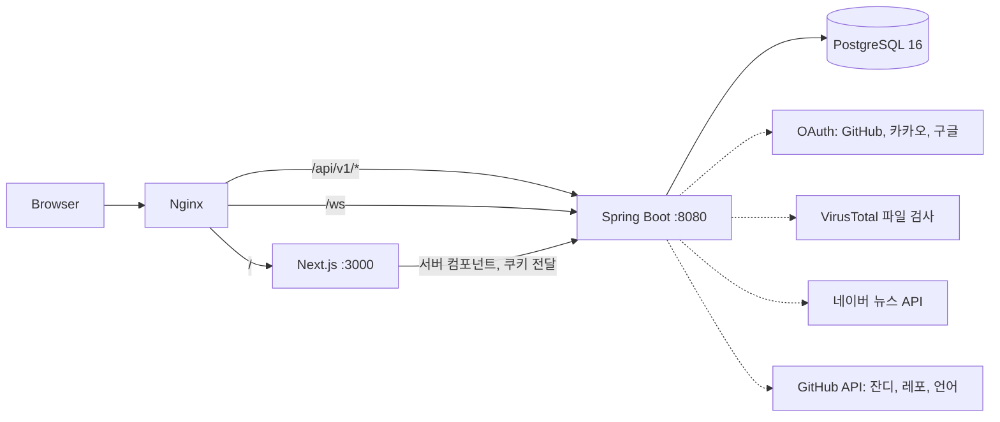

# 찍먹 종합 청사진

> 무엇을 어떤 순서로 만들지, API와 페이지 URL은 무엇인지, 어디서부터 시작하면 되는지를 한곳에 모은 문서다. 구현 전에 먼저 읽는다.
> 메인 피드 화면의 상세 설계는 [main-feed-청사진.md](./main-feed-청사진.md)를 본다. 같은 내용을 훑어보기 쉬운 웹 페이지로도 정리해 두었다(팀 공유용 Artifact).

| 항목 | 내용 |
| --- | --- |
| API 기준 | WBS5 시트 |
| DB 기준 | ERDCloud `ERD_v2` (확인한 테이블 39개) |
| 백엔드 | Java 21 · Spring Boot 3.4.1 · Spring Security · JPA · Gradle · PostgreSQL 16 |
| 프론트 | Next.js 16 · React 19 · TypeScript strict · npm |
| 인증 · 실시간 | 소셜 로그인(GitHub·카카오·구글) + JWT / WebSocket + STOMP + SockJS |
| 배포 | Docker Compose + Nginx |

목차: [1. 시작하기](#1-시작하기) · [2. 진행 현황](#2-진행-현황) · [3. 아키텍처](#3-아키텍처) · [4. 폴더 구조](#4-폴더-구조-3계층) · [5. 도메인과 테이블](#5-도메인과-테이블) · [6. API 전체](#6-api-전체) · [7. 페이지 URL](#7-페이지-url) · [8. 구현 순서](#8-구현-순서) · [9. 작업 규칙](#9-작업-규칙) · [10. 확인이 필요한 항목](#10-확인이-필요한-항목)

---

## 1. 시작하기

**저장소 받기** — 작업 브랜치는 항상 `origin/dev`에서 딴다. `main`, `dev`에 직접 커밋하지 않는다.

```bash
git clone https://github.com/likelion-backendschool-9th/1team_project.git
cd 1team_project
git fetch origin
git switch -c feature/<짧은-설명> origin/dev
```

**프론트 실행** — `http://localhost:3000`이 `/main`으로 이동한다. `API_ORIGIN`을 비워 두면 목 데이터로 화면이 뜬다.

```bash
cd frontend
npm install
npm run dev
```

**백엔드 실행** — PostgreSQL 16이 필요하다([환경설정.md](./환경설정.md)). 현재 백엔드는 뼈대만 있고 API는 아직 없다.

```bash
cd backend
./gradlew bootRun
```

## 2. 진행 현황

2026-11-02 기준.

| 구분 | 상태 | 내용 |
| --- | --- | --- |
| 프론트 | 완료 | 메인 피드 화면 `/main`: 3단 셸, 지금 뜨는 데모, 피드 작성 박스, 피드 카드(좋아요·리포스트·팔로우), 우측 프로필·팔로잉. 목 데이터로 동작. 브랜치 `feature/main-feed-ui`(로컬) |
| 백엔드 | 미착수 | 엔티티, 서비스, 컨트롤러, 인증(JWT·소셜 로그인), WebSocket 전부 아직. 프론트의 API 호출 코드는 WBS5 경로로 작성돼 있어 같은 경로로 만들면 바로 연결된다 |
| 문서 | 정리 필요 | 기존 `기획서.md`, `테이블정의서.md`, `FRONTEND.md`, `BACKEND.md`가 WBS5·ERD_v2보다 오래됨. 구현 첫 PR에서 함께 고친다(10장) |

**기준 자료의 우선순위**

| 대상 | 기준 | 비고 |
| --- | --- | --- |
| API 경로·메서드·페이지 URL | 구글 시트 '응용프로젝트 1팀 WBS'의 `WBS5(페이지 모든 요소 AI)` | 가장 마지막에 수정된 시트 |
| DB 테이블·컬럼 | ERDCloud `ERD_v2` | 목록 하단에 더 있을 수 있어 구현 시 재확인 |
| 기능·화면 요구 | `기획서.md`, 화면 스크린샷 | |
| 코딩·Git 규칙 | `BACKEND.md`, `FRONTEND.md`, `AGENTS.md` | |

## 3. 아키텍처

브라우저는 Nginx 한 곳으로만 들어온다. 프론트는 서버 컴포넌트에서 백엔드를 호출하고, 브라우저 호출은 `/api/v1/*` 프록시를 거친다.



- **인증:** 소셜 로그인 후 백엔드가 Access/Refresh JWT를 발급하고 httpOnly 쿠키로 내려준다. 토큰은 localStorage에 두지 않는다.
- **실시간:** DM과 알림은 WebSocket + STOMP + SockJS. 초기 목록은 서버에서 조회하고 새 메시지만 클라이언트 상태로 받는다.
- **응답 규격:** 성공 `{ "data": ... }`, 목록은 `content/page/size/totalElements/totalPages`, 오류 `{ "error": { "code", "message" } }`.

## 4. 폴더 구조 (3계층)

백엔드와 프론트 모두 "요청을 받는 층 → 업무를 처리하는 층 → 데이터를 다루는 층"으로 나눈다.

### 백엔드: `backend/src/main/java/com/dipsource/backend`

```text
├─ DipSourceApplication.java
├─ global/                      전역 설정, 도메인 로직 금지
│  ├─ config/                   Security, Cors, WebSocket
│  ├─ auth/                     JWT 필터, OAuth2 핸들러
│  ├─ exception/                BusinessException, ErrorCode, GlobalExceptionHandler
│  └─ common/                   BaseEntity, ApiResponse, PageResponse
└─ domain/<도메인>/
   ├─ controller/               [1층] 요청 파싱, 응답 포장만
   ├─ service/                  [2층] 비즈니스 로직, @Transactional
   ├─ repository/ + entity/     [3층] 데이터 접근
   └─ dto/                      record 요청/응답, from(Entity)
```

- 다른 도메인의 repository·entity를 직접 쓰지 않고 그 도메인의 service를 거친다.
- 엔티티를 응답으로 직접 반환하지 않는다. 연관관계는 `LAZY` 단방향이 기본이다.
- 칩 차감처럼 경쟁 조건이 있는 작업은 비관적 잠금(`SELECT ... FOR UPDATE`)을 쓴다.

### 프론트: `frontend/src/app`

```text
├─ layout.tsx · globals.css                   루트(폰트, 스킵 링크, 토큰)
├─ page.tsx                                   /  →  /main redirect
├─ _components/ui/                            도메인을 모르는 공통 UI (Avatar, Icons)
├─ _lib/api/client.ts                         [3층] server-only apiFetch (쿠키 전달, 목 모드)
├─ _lib/types/                                DTO와 이름을 맞춘 타입
├─ (public)/                                  비로그인 가능: login, search, rankings, news
├─ (user)/                                    3단 셸 layout + 회원 화면
│  ├─ _components/                            셸 공통: LeftNav, RightAside, ProfileCard ...
│  ├─ _lib/api.ts                             셸 공통 조회: getMe, getFollowings ...
│  └─ main/                                   라우트 한 개의 구성
│     ├─ page.tsx                             [1층] 조립만, h1 하나
│     ├─ _components/                         화면 조각
│     ├─ _actions.ts · _hooks/                [2층] Server Action, 클라이언트 상태
│     └─ _lib/api.ts                          [3층] 조회 함수 (+ 목 데이터 mock.ts)
└─ admin/                                     관리자
```

- 한 화면에서만 쓰면 `page.tsx` 옆에, 두 곳 이상이면 가장 가까운 공통 부모로 올린다.
- 다른 라우트의 `_components`, `_lib`는 import하지 않는다. 최상위 `components/`, `lib/` 폴더는 만들지 않는다.
- `"use client"`는 클릭·입력이 있는 leaf 컴포넌트에만 붙인다.

> **Next.js 16 주의.** `cacheComponents`가 켜져 있어 `cookies()`, `searchParams`, 캐시되지 않는 fetch는 `<Suspense>` 안에서 읽어야 한다. 코드를 쓰기 전에 `frontend/node_modules/next/dist/docs/`를 확인한다.

## 5. 도메인과 테이블

백엔드 패키지 하나가 맡는 ERD_v2 테이블과 WBS5 그룹이다. 엔티티는 ERD_v2를 기준으로 만든다.

| 도메인 패키지 | ERD_v2 테이블 | WBS5 |
| --- | --- | --- |
| `user` (+auth) | users, social_accounts, user_interest_tags, user_tag_profile, user_sanctions | 1 회원 |
| `follow` · `block` | follows, blocks | 3 소셜 |
| `feed` | feeds, feed_likes, feed_comments, feed_comment_likes, feed_reposts, feed_tags, feed_votes | 2 피드 |
| `tag` | tags | 2.7 |
| `demo` | demos, demo_type_config, demo_tags, demo_likes, demo_feedbacks, demo_feedback_likes, bookmarks | 7 데모 |
| `post` | posts, post_comments, post_comment_likes, post_likes, post_tags, blog_subscriptions | 5 블로그 |
| `minihome` | mini_homes, guestbooks | 6 미니홈피 |
| `dm` | dm_rooms, dm_room_members, dm_messages | 3.7~3.9 |
| `notification` | notifications | 8 알림 |
| `coin` · `subscription` | chip_transactions, blog_subscriptions | 10 칩·구독 |
| `settlement` | settlements | 16.3~16.4 |
| `report` | reports | 2.12, 5.7, 7.12, 15 |
| `admin` | admins, admin_action_logs, user_sanctions | 12~17 |
| `search` · `ranking` · `news` | 전용 테이블 없음(집계, 외부 API) | 4, 9 |

**기존 문서와 다른 점**

- 댓글·좋아요가 `comments`/`likes` 다형성 테이블이 아니라 **도메인별 테이블**(`feed_*`, `post_*`, `demo_*`)이다.
- DM은 `dm_rooms`, `dm_room_members`, `dm_messages` 3개다.
- 도토리는 **칩**이다. `users.chip_balance`, `chip_transactions`.
- `bookmarks`는 데모만 대상이다(`user_id`, `demo_id`). 피드 북마크는 ERD에 없다.
- `feeds`: `content` 500자, `demo_id`, `like/comment/repost_count`, `poll_options`(JSONB), `status`, `deleted_at`.
- `users`: `nickname`, `profile_image`, `bio`, `tech_stacks`(JSONB), `github_username`, `role`, `status`, `chip_balance`.

## 6. API 전체

WBS5 기준. 모든 경로는 `/api/v1/`로 시작한다. **연결됨**은 메인 피드 화면이 이미 이 경로로 호출하게 만들어 둔 항목이다(백엔드는 모두 미착수).

### 1 회원

| 메서드 | 경로 | 페이지 | 비고 |
| --- | --- | --- | --- |
| GET | `auth/login/{provider}` | `/login` | OAuth 리다이렉트 방식 |
| POST | `users/me/profile` | `/onboarding` | 최초 로그인 추가 정보. 필요 여부 확인 |
| POST | `auth/logout` | `/my` | 버튼 위치 확정 필요 |
| POST | `auth/refresh` | 공통 | 토큰 갱신 |
| GET | `users/me` | 공통, `/my` | 팔로워·팔로잉·칩 수 포함. **연결됨** |
| PUT | `users/me` | `/my` | 내 정보 수정 |
| DELETE | `users/me` | `/my` | 회원 탈퇴 |
| GET | `users/{userId}` | `/mini-home/[userId]` | 다른 사용자 프로필 |
| GET · PUT | `users/me/settings` | `/my/settings` | 설정 조회·수정 |

### 2 피드

| 메서드 | 경로 | 페이지 | 비고 |
| --- | --- | --- | --- |
| GET | `feeds?type=recommended` | `/main` | 추천 피드. **연결됨** |
| GET | `feeds?type=following` | `/main` | 팔로잉 피드 |
| POST | `feeds` | `/main` | 500자 제한. **연결됨** |
| GET · PUT · DELETE | `feeds/{feedId}` | `/feeds/[feedId]` | 상세·수정·삭제 |
| GET | `tags` | `/main` | 태그 목록. **연결됨** |
| POST · DELETE | `feeds/{feedId}/like` | `/main`, `/feeds/[feedId]` | 좋아요·취소. **연결됨** |
| POST · DELETE | `feeds/{feedId}/repost` | `/main`, `/feeds/[feedId]` | 리포스트·취소. **연결됨** |
| POST | `feeds/{feedId}/report` | `/main`, `/feeds/[feedId]` | 신고 |
| GET · POST | `feeds/{feedId}/comments` | `/feeds/[feedId]` | 댓글 목록·작성 |
| PUT · DELETE | `feeds/comments/{commentId}` | `/feeds/[feedId]` | 댓글 수정·삭제 |

### 3 소셜 · 4 검색

| 메서드 | 경로 | 페이지 | 비고 |
| --- | --- | --- | --- |
| POST · DELETE | `follows/{userId}` | `/main`, `/feeds/[feedId]`, `/mini-home/[userId]` | 팔로우·언팔로우. **연결됨** |
| GET | `follows/followings` | 공통(우측 사이드), `/my/follows` | **연결됨** |
| GET | `follows/followers` | `/my/follows` | |
| POST · DELETE | `blocks/{userId}` | `/main`, `/feeds/[feedId]`, `/my/settings` | 차단·해제 |
| GET | `dm/rooms` | `/dm` | 대화방 목록 |
| GET | `dm/{userId}` | `/dm/[userId]` | 대화 내역 |
| WS | `dm` | `/dm/[userId]` | WebSocket(STOMP) 전송 |
| GET | `search?q=&type=` | `/search` | 통합 검색. `type`으로 블로그만 검색 가능 |
| GET | `search/popular` | 공통(검색창) | 인기 검색어 |

### 5 블로그

| 메서드 | 경로 | 페이지 |
| --- | --- | --- |
| GET | `posts` | `/blog` |
| GET | `users/{userId}/posts` | `/blog/[userId]` |
| POST | `posts` | `/blog/write` |
| GET · DELETE | `posts/{postId}` | `/blog/posts/[postId]` |
| PUT | `posts/{postId}` | `/blog/posts/[postId]/edit` |
| POST | `posts/{postId}/report` | `/blog/posts/[postId]` |
| GET · POST | `posts/{postId}/comments` | `/blog/posts/[postId]` |
| PUT · DELETE | `posts/comments/{commentId}` | `/blog/posts/[postId]` |

### 6 미니홈피

| 메서드 | 경로 | 페이지 | 비고 |
| --- | --- | --- | --- |
| GET | `mini-homes/{userId}/visitors` | `/mini-home/[userId]` | 방문자 통계 |
| POST | `mini-homes/{userId}/visits` | `/mini-home/[userId]` | 방문 카운트. 하루 1회 제한 여부 확인 |
| GET | `mini-homes/random` | `/mini-home/[userId]` | 파도타기 |
| GET | `users/{userId}/github/{contributions\|repos\|languages}` | `/mini-home/[userId]` | 잔디·대표 레포·언어 통계 |
| GET · POST | `mini-homes/{userId}/comments` | `/mini-home/[userId]` | 일촌평 |
| GET · POST | `mini-homes/{userId}/guestbook` | `/mini-home/[userId]/guestbook` | 방명록 |
| DELETE | `mini-homes/guestbook/{guestbookId}` | `/mini-home/[userId]/guestbook` | 방명록 삭제 |
| PUT | `mini-homes/me` | `/mini-home/[userId]/edit` | 미니홈피 수정(본인만) |
| PUT | `mini-homes/me/featured-demo` | `/mini-home/[userId]/edit` | 대표 데모 설정 |
| GET | `demos?userId={userId}` | `/mini-home/[userId]/demos` | 사용자 데모 목록 |

### 7 데모

| 메서드 | 경로 | 페이지 | 비고 |
| --- | --- | --- | --- |
| POST | `demos` | `/demos/upload` | zip 업로드. 파일 검사는 VirusTotal |
| GET | `demos/{demoId}/status` | `/demos/upload` | 검사 진행률. 폴링/웹소켓 확정 필요 |
| GET | `demos?tag=&sort=&userId=` | `/demos` | 목록 |
| GET | `demos?sort=trending` | `/main` | 지금 뜨는 데모. 기준 정의 필요. **연결됨** |
| GET · PUT · DELETE | `demos/{demoId}` | `/demos/[demoId]` | 상세(좋아요 수 포함)·수정·삭제 |
| POST | `demos/{demoId}/play` | `/main`, `/demos/[demoId]` | 찍먹하기(체험 카운트) |
| POST · DELETE | `demos/{demoId}/like` | `/demos/[demoId]` | 좋아요·취소 |
| POST | `demos/{demoId}/report` | `/demos/[demoId]` | 신고 |
| GET · POST | `demos/{demoId}/comments` | `/demos/[demoId]` | 댓글 목록·작성 |
| PUT · DELETE | `demos/comments/{commentId}` | `/demos/[demoId]` | 댓글 수정·삭제 |

### 8 알림 · 9 뉴스·순위 · 10 칩·구독

| 메서드 | 경로 | 페이지 | 비고 |
| --- | --- | --- | --- |
| GET | `notifications` | `/notifications` | 드롭다운/페이지 확정 필요 |
| GET | `notifications/unread-count` | 공통(우측 사이드) | **연결됨** |
| PUT | `notifications/{notificationId}/read` | `/notifications` | 읽음 처리 |
| GET | `search/news?q=` | `/news` | 네이버 뉴스 API 프록시 |
| GET | `rankings?type=` | `/rankings` | demo / blog / follower / home |
| GET | `rankings?type=&period=weekly` | 공통(좌측 사이드) | 주간 순위 위젯. **연결됨** |
| POST | `coins/purchases` | `/my/coins` | 칩 충전 |
| GET | `coins/history` | `/my/coins` | 충전·사용 내역 |
| POST | (미정) | - | 칩 사용. 기획 후 결정 |
| POST · DELETE | `subscriptions` · `subscriptions/me` | `/my/subscription` | 구독 결제·해지 |

### 12~17 관리자

| 메서드 | 경로 | 페이지 |
| --- | --- | --- |
| GET | `admin/dashboard` | `/admin` |
| GET | `admin/users?q=&status=` | `/admin/users` |
| GET | `admin/users/{userId}` | `/admin/users/[userId]` |
| PUT · DELETE | `admin/users/{userId}/ban` | `/admin/users/[userId]` (제재·해제) |
| GET · DELETE | `admin/demos`, `admin/demos/{demoId}` | `/admin/demos` |
| GET · DELETE | `admin/posts`, `admin/posts/{postId}` | `/admin/posts` |
| GET · DELETE | `admin/feeds`, `admin/feeds/{feedId}` | `/admin/feeds` |
| GET · DELETE | `admin/comments`, `admin/comments/{commentId}` | `/admin/comments` |
| GET | `admin/reports?type=&status=` | `/admin/reports` |
| PUT | `admin/reports/{reportId}` | `/admin/reports/[reportId]` |
| GET | `admin/subscriptions` | `/admin/subscriptions` |
| GET | `admin/revenue?from=&to=` | `/admin/revenue` |
| GET | `admin/settlements` | `/admin/settlements` |
| PUT | `admin/settlements/{settlementId}/confirm` | `/admin/settlements` |
| GET | `admin/coins/purchases?userId=&type=` | `/admin/coins` |
| PUT | `admin/coins/purchases/{purchaseId}/refund` | `/admin/coins` |
| GET | `admin/coins/suspicious` | `/admin/coins/suspicious` |

## 7. 페이지 URL

WBS5 기준 라우트다. 기존 `FRONTEND.md`의 `/`, `/blog/[id]`, `/home/[userId]`는 이 표로 대체한다.

| 영역 | URL | 상태 |
| --- | --- | --- |
| 공통 | `/` → `/main`(redirect), `/login`, `/onboarding` | `/main`만 구현 |
| 피드 | `/main`, `/feeds/[feedId]` | `/main` 완료 |
| 데모 | `/demos`, `/demos/upload`, `/demos/[demoId]` | 예정 |
| 블로그 | `/blog`, `/blog/[userId]`, `/blog/posts/[postId]`, `/blog/posts/[postId]/edit`, `/blog/write` | 예정 |
| 미니홈피 | `/mini-home/[userId]`, `/mini-home/[userId]/edit`, `/mini-home/[userId]/guestbook`, `/mini-home/[userId]/demos` | 예정 |
| 소통 | `/dm`, `/dm/[userId]`, `/notifications` | 예정 |
| 탐색 | `/search`, `/news`, `/rankings` | 예정 |
| 내 정보 | `/my`, `/my/follows`, `/my/settings`, `/my/coins`, `/my/subscription` | 예정 |
| 관리자 | `/admin`, `/admin/users`, `/admin/users/[userId]`, `/admin/demos`, `/admin/posts`, `/admin/feeds`, `/admin/comments`, `/admin/reports`, `/admin/reports/[reportId]`, `/admin/subscriptions`, `/admin/revenue`, `/admin/settlements`, `/admin/coins`, `/admin/coins/suspicious` | 예정 |

## 8. 구현 순서

백엔드는 도메인마다 "엔티티+Repository → Service → Controller+DTO → 테스트"를 한 세트로, 프론트는 "페이지↔API 한 쌍"을 한 PR로 만든다. PR 하나는 목적 하나, 변경 400줄 이하를 권장한다.

| 단계 | 범위 | 상태 |
| --- | --- | --- |
| 0. 기반 | 백엔드 공통(`ApiResponse`, 예외, `BaseEntity`, Security 골격), 프론트 셸·`apiFetch`·공통 UI, 문서 갱신 | 프론트 셸 완료 |
| 1. 핵심 (MVP) | 인증(users, social_accounts) → 팔로우 → 피드 → 데모 → 블로그 → 미니홈피 → 검색 | 진행 중 (메인 피드 프론트 완료) |
| 2. 소셜·소통 | 댓글·좋아요·북마크, DM(WebSocket), 방명록·일촌평, 알림, 순위, GitHub 연동 | 예정 |
| 3. 수익화·관리 | 칩·구독, 정산, 신고·제재, 관리자 전체 | 예정 |
| 4. 부가 기능 | 개발 뉴스, 이벤트, 파도타기, 스킨·테마, 카카오 공유, 차단 목록, 설정 | 예정 |
| 5. 배포 | `docker-compose.yml`: db(postgres:16) · backend(Gradle 멀티스테이지 → JRE 21) · frontend(Next standalone) · nginx. 비밀값은 `.env`, 커밋은 `.env.example`만 | 예정 |

## 9. 작업 규칙

전체 규칙은 [AGENTS.md](../AGENTS.md)다. 자주 쓰는 것만 모았다.

| 구분 | 규칙 |
| --- | --- |
| 브랜치 | `feature/<2~4단어>`, 영어 소문자·숫자·하이픈. 이슈 번호는 PR 본문에 `Closes #12`. `main`, `dev` 직접 푸시 금지 |
| 커밋 | `feat: 카카오 소셜 로그인 추가` 형식. 타입은 feat, fix, refactor, style, docs, test, chore. 제목은 한국어 50자 이내, 마침표 없음. 변경한 파일만 지정해서 add |
| PR | `dev`로 보내고 머지는 사람이 한다. 제목은 커밋 형식, 본문은 PR 템플릿. 푸시 전 `git rebase origin/dev`, 충돌은 임의로 해결하지 말고 공유 |
| 프론트 검증 | `npm run lint`, `npm run build` 통과. Tab 키만으로 전체 흐름 확인. 모바일·데스크톱 모두 확인 |
| 백엔드 검증 | `./gradlew test` 통과. 입력 검증 → 권한 확인 → 비즈니스 로직 → 저장 순서. 비정규화 카운트는 원본과 같은 트랜잭션에서 갱신 |
| 하지 말 것 | WBS5·기획서에 없는 API 가정, `.env`·키·토큰 커밋, `git push --force` |

## 10. 확인이 필요한 항목

구현 전에 팀에서 정해야 하는 것들이다. 정해지면 이 표와 관련 문서를 같이 고친다.

| 항목 | 출처 |
| --- | --- |
| 최초 로그인 후 추가 정보 입력(`/onboarding`)이 필요한가 | WBS5 1.2 |
| "지금 뜨는 데모"의 기준 (좋아요? 체험 수? 기간?) | WBS5 7.5 |
| 알림을 드롭다운으로 할지 별도 페이지로 할지 | WBS5 8.1 |
| 일촌평과 방명록의 차이 | WBS5 6.7 |
| 데모 파일 검사 진행률: 폴링 vs 웹소켓 | WBS5 7.3 |
| 방문 카운트를 하루 1회로 제한할지 | WBS5 6.2 |
| 칩 사용(결제) API 정의 | WBS5 10.3 |
| 피드 북마크, 팔로잉 접속 표시, "이벤트" 메뉴의 API (화면에는 있고 WBS5·ERD_v2에는 없음) | 메인 화면 |
| ERD_v2 전체 테이블 수와 `dm_rooms` 등 신규 테이블 컬럼 확정 | ERD_v2 |
| `AGENTS.md`의 `develop` 표기를 팀 브랜치 `dev`로 고칠지 | Git 규칙 |

**구현 첫 PR에서 같이 고칠 문서**

| 문서 | 고칠 내용 |
| --- | --- |
| `FRONTEND.md` 2-2, 3장 | 라우트·폴더를 7장 기준으로 |
| `기획서.md` 5장 | API 경로·메서드를 6장 기준으로 (`blocks`, `mini-homes`, `GET auth/login`, `notifications`) |
| `테이블정의서.md`, `database-design.md` | ERD_v2 테이블로 (도메인별 댓글·좋아요, DM 3테이블, 칩) |
| `BACKEND.md` 2장 | 패키지를 5장 도메인으로, 다형성 규칙 삭제 |
| `frontend-청사진.md` | 체크리스트의 URL·API를 WBS5로 |
