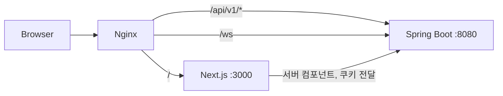

# 찍먹 프론트엔드 청사진

> 프론트엔드를 어떤 순서로, 어떤 구조로 만들지 한곳에 모은 문서다. 구현 전에 먼저 읽는다.
> 백엔드는 프론트엔드 구현이 끝난 뒤에 시작한다. 백엔드 계획은 [백엔드-청사진.md](./백엔드-청사진.md)를 본다.

| 항목 | 내용 |
| --- | --- |
| 프레임워크 | Next.js 16 · React 19 · TypeScript strict · npm |
| 페이지 URL 기준 | WBS5 시트 (`WBS5(페이지 모든 요소 AI)`) |
| API 경로 기준 | [백엔드-청사진.md](./백엔드-청사진.md) 4장 (WBS5 기준) |
| 개발 규칙 | [FRONTEND.md](./FRONTEND.md), [frontend/AGENTS.md](../frontend/AGENTS.md) |
| 배포 | Docker Compose + Nginx (5단계에서 진행) |

목차: [1. 시작하기](#1-시작하기) · [2. 진행 현황](#2-진행-현황) · [3. 아키텍처](#3-아키텍처) · [4. 폴더 구조](#4-폴더-구조) · [5. 페이지 URL](#5-페이지-url) · [6. API 연동 현황](#6-api-연동-현황) · [6-1. 서비스 정책 값](#6-1-서비스-정책-값) · [7. 사용자 흐름](#7-사용자-흐름) · [8. 화면 설계 원칙](#8-화면-설계-원칙) · [9. 구현 순서](#9-구현-순서) · [10. 작업 규칙](#10-작업-규칙) · [11. 확인이 필요한 항목](#11-확인이-필요한-항목)

---

## 1. 시작하기

**저장소 받기** — 작업 브랜치는 항상 `origin/dev`에서 딴다. `main`, `dev`에 직접 커밋하지 않는다.

```bash
git clone https://github.com/likelion-backendschool-9th/1team_project.git
cd 1team_project
git fetch origin
git switch -c feat/<짧은-설명> origin/dev
```

**프론트 실행** — `http://localhost:3000`이 `/main`으로 이동한다. `API_ORIGIN`을 비워 두면 목 데이터로 화면이 뜬다. 백엔드가 없어도 프론트 작업은 막히지 않는다.

```bash
cd frontend
npm install
npm run dev
```

## 2. 진행 현황

2026-11-08 기준.

| 구분 | 상태 | 내용 |
| --- | --- | --- |
| 메인 피드 `/main` | 완료 | 3단 셸, 지금 뜨는 데모, 피드 작성 박스, 피드 카드(좋아요·리포스트·팔로우·북마크·댓글), 우측 프로필·팔로잉. 실서버 연동 |
| 블로그 `/blog` | 완료 | 전용 셸, 검색·분류·정렬 URL 쿼리. CRUD·북마크·신고 실서버 연동. 블로그 댓글은 스텁 |
| 미니홈피 `/mini-home/[userId]` | 완료 | 셸 없는 단독 화면. 프로필·잔디·레포, 대표 데모·최근 글·일촌평·방명록·파도타기. 신고 모달(유저·방명록) 🔄 PR 리뷰 중(#137) |
| 로그인·온보딩 `/login`, `/onboarding` | 완료 | 소셜 3종(GitHub·카카오·구글). 온보딩 한 화면 처리. 카카오 로그인 실서버 연동 완료 |
| 피드 상세 `/feeds/[feedId]` | 완료 | 댓글 CRUD·좋아요·신고 연결. 🔄 댓글 신고 PR 리뷰 중(#137) |
| 나머지 회원·관리자 화면 | 완료(목) | 5장 표의 모든 URL. 공통 UI 키트(`_components/ui/kit.module.css`, `LinkTabs`, `ConfirmButton`, `Pagination`, `CommentForm`, `ReportModal`)와 변경 공통 처리(`_lib/api/mutate.ts`, `formAction.ts`)를 쓴다 |
| 문서 | 정리 필요 | `FRONTEND.md`의 라우트·폴더가 5장·4장보다 오래됨. 구현 첫 PR에서 함께 고친다(9장) |

## 3. 아키텍처

브라우저는 Nginx 한 곳으로만 들어온다. 프론트는 서버 컴포넌트에서 백엔드를 호출하고, 브라우저 호출은 `/api/v1/*` 프록시를 거친다.



- **인증:** 소셜 로그인 후 백엔드가 Access/Refresh JWT를 httpOnly 쿠키로 내려준다. 토큰은 localStorage에 두지 않는다.
- **실시간:** DM과 알림은 WebSocket + STOMP + SockJS. 초기 목록은 서버에서 조회하고 새 메시지만 클라이언트 상태로 받는다.
- **응답 규격:** 성공 `{ "data": ... }`, 목록은 `content/page/size/totalElements/totalPages`, 오류 `{ "error": { "code", "message" } }`.
- **목 모드:** `API_ORIGIN`이 비어 있으면 `client.ts`의 `isMockMode`가 켜지고, 각 `_lib/api.ts`·`_actions.ts`가 `mock.ts`의 목 데이터를 돌려준다. 백엔드가 생기면 환경변수만 채우면 같은 경로로 연결된다.

## 4. 폴더 구조

요청을 받는 층(page) → 업무를 처리하는 층(actions, hooks) → 데이터를 다루는 층(api) 3계층으로 나눈다.

```text
frontend/src/app
├─ layout.tsx · globals.css                   루트(폰트, 스킵 링크, 토큰)
├─ _components/ui/                            도메인을 모르는 공통 UI (Avatar, Icons)
├─ _lib/api/client.ts                         [3층] server-only apiFetch (쿠키 전달) + isMockMode 플래그
├─ _lib/types/                                DTO와 이름을 맞춘 타입
├─ (public)/                                  셸 없는 단독 화면: login, onboarding
├─ (user)/                                    3단 셸 layout + 회원 화면
│  ├─ _components/                            셸 공통: LeftNav, RightAside, ProfileCard ...
│  ├─ _lib/api.ts                             셸 공통 조회: getMe, getFollowings ...
│  ├─ (feed)/layout.tsx                       피드 3단 셸: main, feeds, demos, dm, search, news, rankings, events, my
│  ├─ (feed)/_components · _actions.ts        피드 카드·좋아요·팔로우처럼 셸 안 여러 화면이 쓰는 조각
│  ├─ blog/layout.tsx                         블로그 전용 셸 (blog 하위 전체)
│  ├─ mini-home/[userId]/layout.tsx           셸 없는 미니홈피 틀 (헤더·프로필·탭을 홈/데모/방명록/스킨이 공유)
│  └─ (feed)/main/                            라우트 한 개의 구성
│     ├─ page.tsx                             [1층] 조립만, h1 하나
│     ├─ _components/                         화면 조각
│     ├─ _actions.ts · _hooks/                [2층] Server Action, 클라이언트 상태
│     └─ _lib/api.ts                          [3층] 조회 함수 (+ 목 데이터 mock.ts)
└─ admin/                                     관리자 (상단 헤더 메뉴바 layout, noindex)
```

- 한 화면에서만 쓰면 `page.tsx` 옆에, 두 곳 이상이면 가장 가까운 공통 부모로 올린다.
- 다른 라우트의 `_components`, `_lib`는 import하지 않는다. 최상위 `components/`, `lib/` 폴더는 만들지 않는다.
- `"use client"`는 클릭·입력이 있는 leaf 컴포넌트에만 붙인다.
- `/` → `/main` 이동은 `next.config.ts`의 `redirects()`로 처리한다. `page.tsx`에서 `redirect()`를 쓰면 Partial Prefetching 검증 에러가 난다.

> **Next.js 16 주의.** `cacheComponents`가 켜져 있어 `cookies()`, `searchParams`, 캐시되지 않는 fetch는 `<Suspense>` 안에서 읽어야 한다. 코드를 쓰기 전에 `frontend/node_modules/next/dist/docs/`를 확인한다.

## 5. 페이지 URL

WBS5 기준 라우트다. 기존 `FRONTEND.md`의 `/`, `/blog/[id]`, `/home/[userId]`는 이 표로 대체한다.

| 영역 | URL | 상태 |
| --- | --- | --- |
| 공통 | `/` → `/main`(redirect), `/login`, `/onboarding` | 로그인·온보딩 완료(목) |
| 피드 | `/main`, `/feeds/[feedId]` | 완료(목) |
| 데모 | `/demos`, `/demos/upload`, `/mini-home/[userId]/demos/[demoId]` (`/demos/[demoId]`는 이쪽으로 리다이렉트) | 완료(목) |
| 블로그 | `/blog`, `/blog/[userId]`, `/blog/posts/[postId]`, `/blog/posts/[postId]/edit`, `/blog/write` | 완료(목) |
| 미니홈피 | `/mini-home/[userId]`, `/mini-home/[userId]/edit`, `/mini-home/[userId]/guestbook`, `/mini-home/[userId]/demos` | 완료(목) |
| 소통 | DM 창 (페이지 없이 오른쪽 아래 DM 버튼으로 여닫음), (알림은 별도 페이지 없이 프로필 카드의 알림 버튼 아래 드롭다운) | 완료(목) |
| 탐색 | `/search`, `/news`, `/rankings` | 완료(목) |
| 이벤트 | `/events`, `/events/[eventId]` | 완료(목) |
| 내 정보 | `/my`, `/my/follows`, `/my/bookmarks`, `/my/settings`, `/my/coins`, `/my/subscription` | 완료(목) |
| 관리자 | `/admin`, `/admin/users`, `/admin/users/[userId]`, `/admin/demos`, `/admin/posts`, `/admin/feeds`, `/admin/comments`, `/admin/events`, `/admin/reports`, `/admin/reports/[reportId]`, `/admin/subscriptions`, `/admin/revenue`, `/admin/settlements`, `/admin/coins`, `/admin/coins/suspicious` | 완료(목) |

## 6. API 연동 현황

전체 API 목록은 [백엔드-청사진.md](./백엔드-청사진.md) 4장에 있다. 프론트는 이 경로로 호출 코드를 먼저 만들고, 백엔드가 생기기 전까지는 목 데이터를 쓴다. 아래는 메인 피드 화면이 이미 호출하게 만들어 둔 경로다.

| 메서드 | 경로 | 쓰는 곳 |
| --- | --- | --- |
| GET | `users/me` | 셸 공통, 프로필 카드 |
| GET | `feeds?type=recommended` | `/main` 피드 목록 |
| POST | `feeds` | `/main` 피드 작성 |
| GET | `tags` | `/main` 태그 칩 |
| POST · DELETE | `feeds/{feedId}/like` | 피드 카드 좋아요 |
| POST · DELETE | `feeds/{feedId}/repost` | 피드 카드 리포스트 |
| POST · DELETE | `follows/{userId}` | 피드 카드 팔로우 |
| GET | `follows/followings` | 우측 팔로잉 목록 |
| GET | `demos?sort=trending` | 지금 뜨는 데모 |
| GET | `notifications/unread-count` | 프로필 카드 알림 배지 |
| GET | `rankings?type=&period=weekly` | 좌측 오늘의 개발자 |

## 6-1. 서비스 정책 값

설정 정리(2026-11-02) 기준이다. 코드에서는 `src/app/_lib/policy.ts` 한 곳에서만 값을 바꾼다.

| 항목 | 값 |
| --- | --- |
| 칩 환율 | 1칩 = 200원 |
| 블로그 구독 | 월 결제, 현금 자동이체 (칩 아님) |
| 블로그 글 잠금해제 | 칩 결제. 잠금 여부와 칩 개수는 글쓴이가 정한다 |
| 피드 | 결제 없음 |
| 미니홈피 데모 | 보여지는 데모는 전부 무료. 일반 3개, 딥소스 플러스 6개까지 공개 |
| 미니홈피 칩 후원 | 주는 사람이 원하는 만큼 양도 |
| 데모 인벤토리 | 기본 6칸, 1칸 추가에 10칩, 딥소스 플러스는 +2칸 |
| 딥소스 플러스 | 월 결제(현금 자동이체). 데모 6개 공개, 스킨 커스텀, BGM, 고급 배지, 인벤토리 +2 |
| 회사 인증 | 인증 버튼만 구현. 인증되면 프로필에 회사 태그 표시 |
| BGM | 무료 mp3를 `public/bgm/`에 넣고 플레이리스트로 고르는 방식 |

## 7. 사용자 흐름

### 비회원

1. 메인 `/main`에서 인기 데모·피드·순위를 탐색한다.
2. 데모 상세 `/mini-home/[userId]/demos/[demoId]`(작성자 미니홈피 안)에서 정보를 확인한다. "찍먹하기"(실행)·좋아요·댓글·DM은 로그인 유도 팝업을 띄운다.
3. 블로그, 미니홈피, 검색, 순위는 자유롭게 조회한다.
4. 소셜 로그인(`/login`)으로 GitHub·카카오·구글 중 선택해 가입/로그인한다.

### 회원 — 데모

1. `/demos/upload`에서 zip 파일을 업로드한다. 확장자·용량 검사 결과를 즉시 보여준다.
2. 업로드 성공 → `/demos/[demoId]` 상세로 이동한다.
3. 다른 사람의 데모에서 "찍먹하기" 클릭 → 새 창에서 샌드박스 실행. `play_count` 증가.
4. 댓글(질문·버그·칭찬), 좋아요 토글, 북마크(나중에 해보기) 토글.

### 회원 — 미니홈피

1. `/mini-home/[userId]`에서 프로필·대표 데모·프로젝트관·방명록·방문자 통계를 확인한다.
2. 본인 홈피: `/mini-home/[userId]/edit`에서 스킨·대표 데모·소개 수정.
3. 다른 사람 홈피: 방명록 작성 (비밀글 옵션), 팔로우·구독 버튼.
4. "파도타기" → 랜덤 미니홈피로 이동.

### 회원 — 블로그

1. `/blog/write`에서 마크다운 글 작성. 데모 연결(선택), 유료/무료 설정.
2. 작성 성공 → `/blog/posts/[postId]`로 이동.
3. 유료 글은 구독자 또는 칩 결제자만 전문 조회. 비구독자에게는 미리보기.
4. `/blog/posts/[postId]/edit`에서 본인 글 수정. 삭제는 상세에서 확인 후 처리.

### 회원 — 피드·DM·결제

1. `/main`에서 팔로잉/추천 피드 조회, 피드 작성 (짧은 글 + 투표).
2. DM 창에서 WebSocket으로 실시간 메시지 전송·수신. 읽음 표시.
3. `/my/coins`에서 칩 충전. 상대 미니홈피에서 구독 버튼 → 칩 차감.

### 관리자

1. `/admin` 대시보드에서 통계 확인 (가입자, 데모 업로드, 신고, 매출).
2. 공통 목록 패턴: 검색, 상태 필터, 정렬, 페이지 이동.
3. 회원 관리: 목록 → 상세 → 제재(일/주/월/영구) · 해제.
4. 콘텐츠 관리: 데모·블로그·피드·댓글 목록 → 삭제.
5. 신고 관리: 신고 목록 (대기 우선) → 처리 (숨김·제재·기각 + 사유).
6. 정산: 게시자별 수익, 수수료, 정산 확정.
7. 가상화폐: 충전 내역, 환불 처리, 부정 사용 확인.

---

## 8. 화면 설계 원칙

- **공통:** 헤더/사이드바, 로그인 상태, 반응형 레이아웃, 접근 가능한 폼·대화상자·상태 메시지를 먼저 만든다.
- **목록:** 결과 수, 검색/필터, 빈 결과, 로딩, 오류, 페이지 이동을 공통 패턴으로 만든다. 필터 상태는 URL 쿼리에 보존해 공유와 뒤로 가기를 지원한다.
- **상세:** 핵심 정보와 가능한 행동을 분리한다. 데모 상세에서는 실행·소셜 행동을 눈에 띄게 배치한다.
- **폼:** 필수값, 입력 형식, 서버 검증 오류, 저장 중 상태, 저장 성공 후 이동을 일관되게 처리한다. 중복 제출을 막는다.
- **변경 작업:** 삭제·차단·제재는 확인 대화상자를 띄우고 결과를 명확히 알린다.
- **모바일:** 회원 화면(피드·데모·미니홈피·DM)은 작은 화면을 우선 설계한다. 관리자 표는 좁은 화면에서 카드/가로 스크롤 등 읽기 가능한 대안을 제공한다.
- **실시간:** DM·알림은 WebSocket 연결 상태를 표시한다. 연결이 끊기면 재연결 시도 중임을 안내한다.

---

## 9. 구현 순서

프론트는 "페이지↔API 한 쌍"을 한 PR로 만든다. PR 하나는 목적 하나, 변경 400줄 이하를 권장한다. 백엔드가 없는 동안에는 목 데이터로 화면을 끝까지 만든다.

| 단계 | 범위 | 상태 |
| --- | --- | --- |
| 0. 기반 | 셸, `apiFetch`, 공통 UI, 문서 갱신 | ✅ 완료 |
| 1. 핵심 (MVP) | 로그인 → 피드 → 데모 → 블로그 → 미니홈피 → 검색 | ✅ 완료(목) (데모는 목만) |
| 2. 소셜·소통 | 댓글·좋아요·북마크, DM, 방명록·일촌평, 알림, 순위 | 🟡 대부분 실서버 연동 완료. 알림·순위 목 |
| 3. 수익화·관리 | 칩·구독, 신고, 관리자 화면 | 🟡 신고 모달 UI 완료, 실서버 연결 🔄 PR 리뷰 중(#137). 칩·구독 목, 관리자 화면 목 |
| 4. 부가 기능 | 개발 뉴스, 이벤트, 스킨·테마, 설정 | 예정 |
| 5. 배포 | Next standalone 이미지, nginx 설정 | 예정 |

## 10. 작업 규칙

전체 규칙은 [AGENTS.md](../AGENTS.md)다. 자주 쓰는 것만 모았다.

| 구분 | 규칙 |
| --- | --- |
| 브랜치 | `타입/작업명`. 타입은 feat, fix, refactor, docs, test, chore, hotfix, perf, design. 영어 소문자와 하이픈만 쓰고 하나의 브랜치에는 하나의 작업만 담는다. 예: `feat/main-feed-ui`. 이슈 번호는 PR 본문에 `Closes #12`. `main`, `dev` 직접 푸시 금지 |
| 커밋 | `타입: 작업 내용` 형식. 제목은 한국어 50자 이내, 마침표 없음. 변경한 파일만 지정해서 add |
| PR | `dev`로 보내고 머지는 사람이 한다. 제목은 커밋 형식, 본문은 `.github/pull_request_template.md` 항목을 모두 채운다. 푸시 전 `git rebase origin/dev`, 충돌은 임의로 해결하지 말고 공유 |
| 검증 | `npm run lint`, `npm run build` 통과. Tab 키만으로 전체 흐름 확인. 모바일·데스크톱 모두 확인 |
| 하지 말 것 | WBS5·기획서에 없는 API 가정, `.env`·키·토큰 커밋, `git push --force` |

## 11. 확인이 필요한 항목

구현 전에 팀에서 정해야 하는 것들이다. 정해지면 이 표와 관련 문서를 같이 고친다.

| 항목 | 출처 |
| --- | --- |
| 최초 로그인 후 추가 정보 입력(`/onboarding`)이 필요한가 (목으로 구현함: 기본 정보 → 기술 스택 → 관심분야 → 관심주제 4단계, 태그는 각 2개 이상. 저장 API·태그 목록·관심분야/관심주제 저장 컬럼 필요) | WBS5 1.2 |
| "지금 뜨는 데모"의 기준 (좋아요? 체험 수? 기간?) | WBS5 7.5 |
| 일촌평과 방명록의 차이 | WBS5 6.7 |
| 데모 파일 검사 진행률: 폴링 vs 웹소켓 | WBS5 7.3 |
| 피드 북마크, 팔로잉 접속 표시, "이벤트" 메뉴의 API (화면에는 있고 WBS5에는 없음) | 메인 화면 |
| 순위 위젯 `rankings?period=`에 `daily`·`monthly`도 지원하는가 (좌측 오늘/이번주/이번달 탭), 사용자 배지 API와 최대 개수(화면은 3개) | 메인 화면 |
| 인기 연재 시리즈, 아티클 순위(조회·좋아요·팔로우), 구독 중인 작가, 글 좋아요·북마크 API. 지금은 목 데이터만 쓴다 | 블로그 화면 |
| `GET posts`의 `category`·`sort`·`q` 쿼리 이름 | 블로그 화면 |
| 미니홈피 프로필(`GET users/{userId}`)에 대표 데모 id·제작기 글 id·BGM·한 줄 소개가 포함되는가 | 미니홈피 화면 |
| 데모 업로드는 multipart라 `apiFetch`(JSON 고정)와 별도 요청기가 필요하다 | `/demos/upload` |
| 칩 사용 API(WBS 10.3 "기획 후 결정"): 유료 글 잠금해제, 미니홈피 칩 후원, 데모 인벤토리 +1칸이 모두 여기에 묶인다. 지금은 목 응답만 준다 | 블로그·미니홈피 |
| 딥소스 플러스 월 요금(지금은 임시 4,900원), 플러스 구독·조회 API(`subscriptions`에 `plan` 구분을 둘지) | `/my/subscription` |
| 블로그 구독 목록 조회 API, 블로그 주인 정보(구독자 수·월 구독료) 응답 위치 | 블로그·내 정보 화면 |
| 미니홈피 프로필에 플러스 여부·스킨·공개 데모 id·인벤토리 추가 칸·회사 태그가 포함되는가 | 미니홈피 화면 |
| 블로그 글 좋아요 API (WBS에 없음, 화면 상태만 바뀜) | 블로그 화면 |
| 알림 "모두 읽음" 일괄 API (지금은 알림마다 `notifications/{id}/read` 호출) | 알림 드롭다운 |
| BGM 음원 파일: `public/bgm/`에 저작권 없는 mp3를 넣으면 재생된다. 아직 파일 없음 | 미니홈피 |
| DM 전송은 WebSocket 연결 전까지 화면에만 추가된다 | DM 창 |
| 방문 카운트(`POST mini-homes/{userId}/visits`) 호출 시점, 데모 "나중에 해보기"(북마크) API | 미니홈피 화면 |
| `AGENTS.md`의 `develop` 표기를 팀 브랜치 `dev`로 고칠지 | Git 규칙 |

**구현 첫 PR에서 같이 고칠 문서**

| 문서 | 고칠 내용 |
| --- | --- |
| `FRONTEND.md` 2-2, 3장 | 라우트·폴더를 4·5장 기준으로 |
| `프론트엔드-청사진.md` | 사용자 흐름·화면 설계 원칙 통합 완료 |
